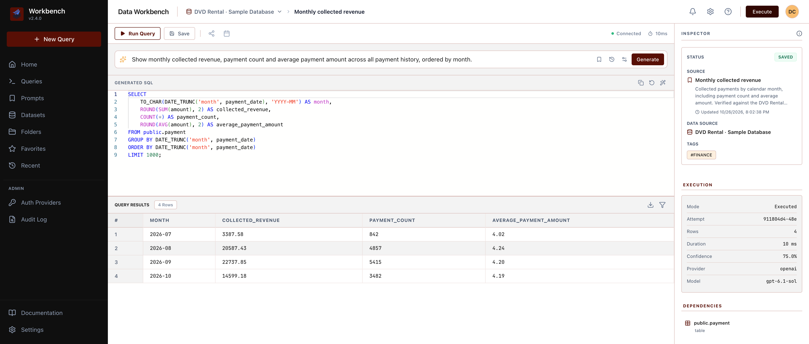
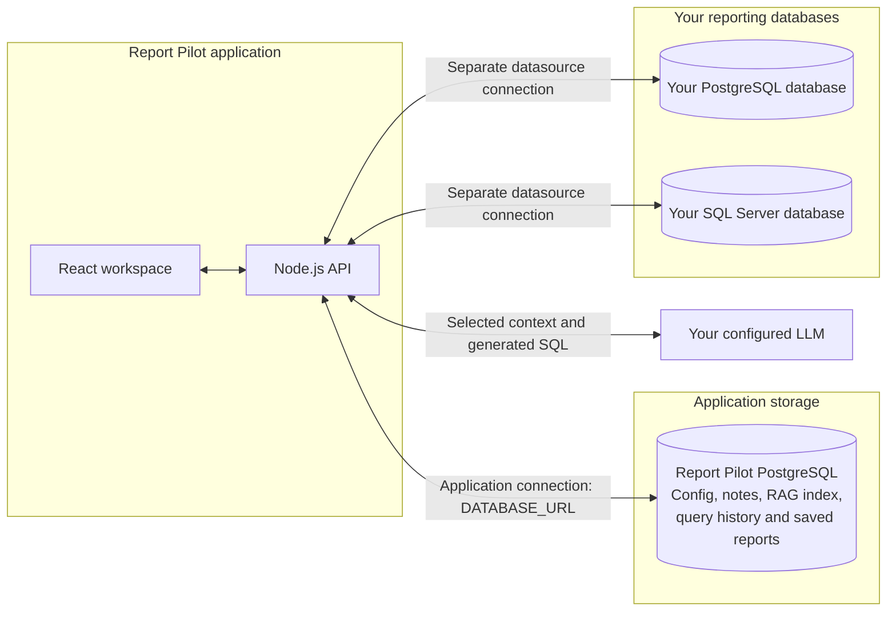
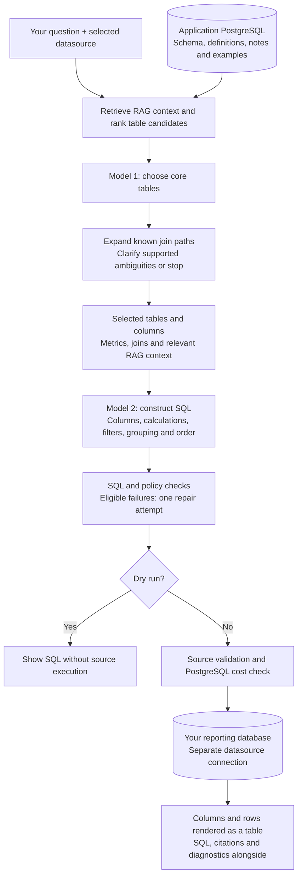
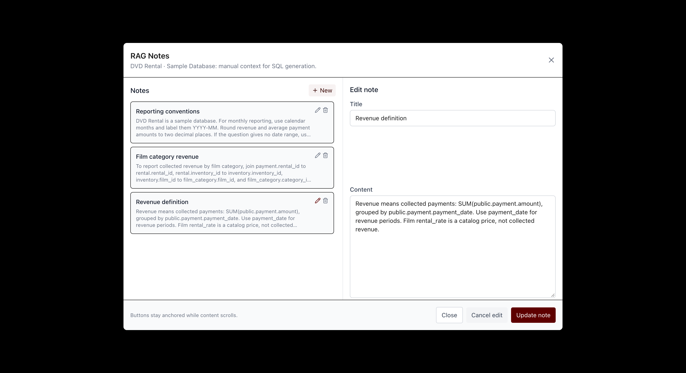

# Report Pilot

**Ask your database a question. Inspect the SQL. Save it as a reusable report.**

Report Pilot is a self-hosted reporting workspace for PostgreSQL and Microsoft SQL Server. It turns natural-language questions into read-only SQL using your schema, business definitions, and reviewed examples, then brings the query, results, and supporting context into one place.

It is built for analysts who need repeatable reports and developers who want to give teams a SQL assistant grounded in their own database.

[Get started](docs/getting-started.md) · [Configure RAG](docs/rag.md) · [Try the examples](docs/examples/dvd-rental.md) · [API reference](docs/api/openapi.yaml)



*A live query against the bundled DVD Rental sample database, generated with OpenAI `gpt-6.1-sol`. The four monthly totals were checked against an independently written SQL query. [Run conditions and reference SQL](docs/examples/dvd-rental.md).*

## From a question to a report

1. **Connect a database.** Discover tables, views, columns, and relationships using a read-only database account.
2. **Explain your business.** Define what “revenue” means, which dates matter, and which joins are appropriate.
3. **Ask a question.** Report Pilot retrieves relevant context, selects tables and join paths, and generates SQL. Supported ambiguities prompt you to choose an interpretation.
4. **Review the answer.** Normal generation runs the query after validation. Inspect the SQL and results, or select **Dry run** to inspect and edit the SQL before executing it.
5. **Reuse the work.** Save and tag queries, review versions, share access, and export results. The API also supports parameterized runs and scheduled email reports.

For example:

> Show monthly collected revenue, payment count, and average payment amount for all available payment history, ordered by month.

Or compare category performance:

> Which five film categories generated the most collected payment revenue across all payment history?

## What you can do

| Capability | What it gives you |
| --- | --- |
| Natural-language SQL workspace | Editable SQL, tabular results, dry runs, prompt history, and reusable prompt presets. |
| Database-aware context | Schema discovery, semantic names, metric definitions, join policies, RAG notes, and validated question-to-SQL examples. |
| Reusable reports | Saved queries, tags, version history, access sharing, and parameterized execution through the API. |
| Exports and delivery | JSON, CSV, TSV, Excel, and Parquet exports; SMTP email and opt-in saved-query scheduling through the API. |
| Access and diagnostics | Roles and datasource permissions, OIDC sign-in, SCIM provisioning, audit events, query diagnostics, and optional OpenTelemetry. |
| Model choice | OpenAI, Gemini, DeepSeek, OpenRouter, and custom OpenAI-compatible endpoints, including local model servers. |

## How it works

Report Pilot uses two distinct database roles: **its own application database** and **the reporting databases you connect**. They have separate connections and can run on different servers. For example, Report Pilot can store its configuration and RAG index in PostgreSQL while querying your company's SQL Server database.



The application database is configured with `DATABASE_URL`. Each reporting datasource has its own connection configured in **Datasets**. Report Pilot reads schema metadata from that source, builds its RAG index in the application database, and validates generated SQL before executing it against the selected source. The source does not need Report Pilot's tables, notes, or configuration installed in it.

RAG retrieves relevant schema descriptions, business definitions, notes, and reviewed examples from application storage for each question. Business records are queried from the source database; they do not need to be copied into the application database. No separate vector database is required.

SQL generation and embeddings are configured separately. Use OpenAI or Gemini embeddings, or the local hash fallback. Schema, questions, business context, and relevant SQL are sent to the configured generation provider. Choose the provider and deployment to fit your data requirements.

[The RAG guide](docs/rag.md) covers setup, automatic reindexing, table selection, clarification, feedback, and the difference between generation and embedding models.

## How a question becomes a result

Two model calls handle different decisions. First, the schema linker chooses core tables from a ranked shortlist. Application code expands their join paths. Then the SQL generator decides the calculations, filters, grouping, output columns, and order using that schema and business context.



The UI displays the shape returned by SQL. It does not currently choose a chart or generate a narrative answer. Citations and confidence help with inspection but do not verify business correctness.

**[Explore the full query pipeline and guardrails](docs/query-pipeline.md)** for the exact retrieval limits, table and join decisions, repair flow, and differences between generated queries, saved reports, and exports. The guide also documents current gaps, including reliance on database grants for read-only enforcement, heuristic column exclusions, and resource-limit coverage.

## Give the assistant the context your schema is missing

A column named `amount` cannot explain your reporting rules. Add notes such as:

> Revenue means collected payments: `SUM(public.payment.amount)`, grouped by `payment_date`. Film `rental_rate` is a catalog price, not collected revenue.



These notes are retrieved with schema context. Corrected-SQL feedback can also become a validated example for later questions. Saving a query alone does not add a training example or fine-tune a model.

## Run it locally

You need Node.js 22 (see `.nvmrc`), npm, and Docker Compose. Start with:

```bash
git clone https://github.com/dcoric/report-pilot.git
cd report-pilot
npm run setup
cp .env.example .env
docker compose up -d db
```

Then follow the **[local setup guide](docs/getting-started.md)** to start the API and frontend, create an administrator, configure a model, and connect the bundled sample database. There is no default application login.

## Project status

Report Pilot is under active development. The query workspace, schema discovery, RAG notes, saved-query workflow, and exports are available today. Some navigation items and workspace actions are marked **Coming soon**; scheduling and some administration capabilities are exposed through the API rather than a complete UI.

Read-only checks, query budgets, and citations help make generated SQL inspectable. They do not prove business correctness, and the confidence indicator is a heuristic. Use database-level read-only permissions and verify important reports against known results. Scheduled delivery is opt-in and currently assumes a single API process.

The repository includes browser smoke tests, backend tests, schema-linking regression gates, and a 60-question DVD Rental evaluation dataset. The screenshots document two checked examples, not an overall accuracy score. See [development and evaluation](docs/development.md) for commands and current evaluation limits.

## Documentation

| Guide | Start here when you want to… |
| --- | --- |
| [Getting started](docs/getting-started.md) | Run the application and ask your first question. |
| [RAG setup and architecture](docs/rag.md) | Add business context and understand retrieval. |
| [Query pipeline and guardrails](docs/query-pipeline.md) | Follow table selection, SQL construction, results, and enforcement limits. |
| [DVD Rental examples](docs/examples/dvd-rental.md) | Reproduce the screenshots and check the answers. |
| [Test databases](test-data/README.md) | Load PostgreSQL or SQL Server fixtures and import DDL. |
| [API schema](docs/api/openapi.yaml) | Integrate queries, reports, exports, and administration. |
| [Development and evaluation](docs/development.md) | Build, test, inspect diagnostics, and understand benchmark coverage. |
| [OpenTelemetry](docs/observability/opentelemetry.md) | Configure optional traces and metrics. |

Licensed under the [MIT License](LICENSE).
