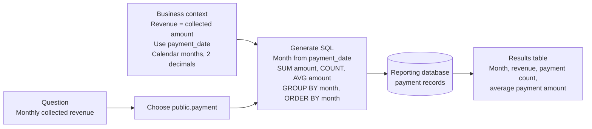
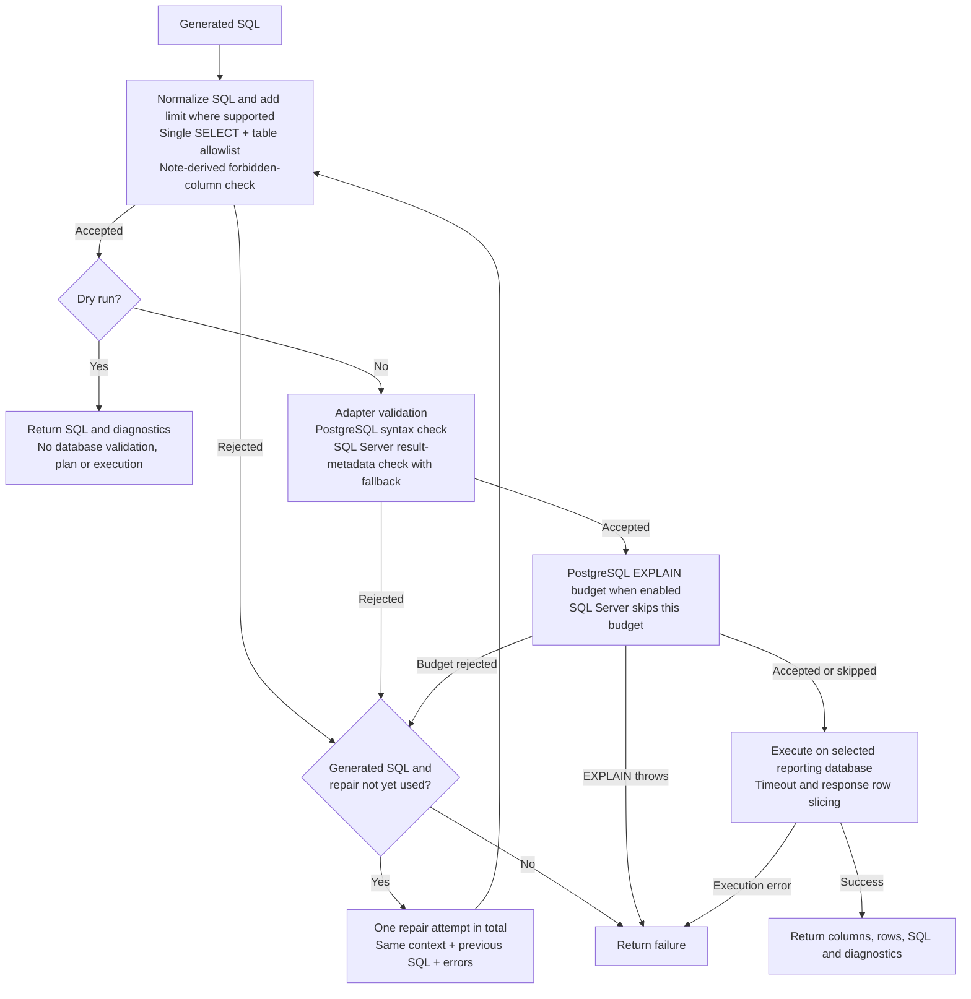

# How a question becomes a result

Report Pilot makes two model decisions: **which core tables are relevant**, then **what SQL answers the question**. Application code retrieves context, connects tables, checks the SQL, and executes it. The SQL determines the result's columns, calculations, filters, grouping, and order. The current UI renders a table; there is no separate model that chooses a chart or writes a narrative answer.

This guide describes the implementation inspected on 26 October 2026, based on commit `ed559b7` and the local README demonstration changes. It distinguishes implemented checks from their limits. Defaults below are the current query-workspace defaults, not guarantees for every execution endpoint.

## The full construction path

Blue nodes are model decisions. Green nodes are deterministic application work. Orange nodes need user input. The reporting database is separate from Report Pilot's application PostgreSQL database.

```mermaid
flowchart TD
    Input["Your question + selected datasource<br/>Provider, model, row limit and dry-run option"] --> Access["Check query permission<br/>and datasource access"]
    Access --> Retrieve["Retrieve datasource context<br/>Rank table cards and RAG documents"]
    AppDB[("Application PostgreSQL<br/>Schema catalog, RAG index,<br/>definitions, notes and examples")] --> Retrieve
    Retrieve --> Candidates["Shortlist up to 15 relevant tables<br/>Names, aliases, descriptions and schema RAG scores"]
    Candidates --> Interpretation{"Known table or<br/>metric ambiguity?"}
    Interpretation -->|Yes| Choose["You choose an interpretation"]
    Choose --> Linker
    Interpretation -->|No| Linker["MODEL 1: select core tables<br/>Choose 1 to 8 IDs from the shortlist"]
    Linker --> Graph["Expand the schema graph<br/>Discovered relationships + approved join policies<br/>At most 2 intermediate tables per path"]
    Graph --> Path{"Connected and<br/>unambiguous?"}
    Path -->|Several equal paths| JoinChoice["You choose a join path"]
    JoinChoice --> Context
    Path -->|No connection| Stop["Stop with schema-linking error"]
    Path -->|Yes| Context["Build SQL context<br/>Expanded tables and columns, metrics,<br/>join policies and up to 12 RAG documents"]
    Context --> Generator["MODEL 2: generate SQL<br/>SELECT, JOIN, WHERE, GROUP BY,<br/>ORDER BY and row limit"]
    Generator --> Checks["Validate and apply eligible repair<br/>See the guardrail flow below"]
    Checks --> Mode{"Dry run?"}
    Mode -->|Yes| SQL["Show SQL and diagnostics<br/>No source execution or EXPLAIN"]
    Mode -->|No| Source[("Selected reporting database<br/>Its own connection and permissions")]
    Source --> Rows["Database returns columns and rows"]
    Rows --> UI["UI renders a results table<br/>SQL aliases become column headings<br/>Also show SQL, citations and confidence"]
    classDef model fill:#e8efff,stroke:#4263eb,color:#15234a;
    classDef code fill:#edf7ee,stroke:#40844b,color:#183c20;
    classDef human fill:#fff2d9,stroke:#bc7c1c,color:#513508;
    class Linker,Generator model;
    class Access,Retrieve,Candidates,Graph,Context,Checks,Rows,UI code;
    class Input,Choose,JoinChoice human;
```

The diagram follows a fresh natural-language request. An exact prompt-history match or manually executed SQL can take the `sql_override` path instead, skipping table selection and SQL generation. See [execution-path differences](#execution-path-differences).

## What RAG contributes, and when

1. **Retrieve within the selected datasource.** The service loads non-ignored table cards and retrieves up to 45 RAG documents in parallel. Retrieval uses the current index version, PostgreSQL full-text candidate selection, stored embedding similarity, and reranking. The local hash embedding fallback is functional but is not a learned semantic embedding model.
2. **Build the table shortlist.** Ranking combines table/schema names, descriptions, semantic aliases, weighted synonyms, and retrieved schema-document scores. Only positive-score candidates survive. An empty shortlist stops generation. Business context can influence retrieval, but the first model receives table cards rather than the full final SQL prompt.
3. **Resolve supported ambiguities.** Deterministic checks recognize competing semantic aliases and same-name tables across schemas. They do not detect every ambiguity in a business question. The linker then returns structured JSON with known table IDs, concepts, and a reason. Invalid IDs or malformed responses cause provider retry. If all linker providers fail, it selects the highest-ranked single candidate as a fallback.
4. **Find connecting tables.** The graph uses discovered relationships and structured approved join policies. It can add connector tables outside the initial shortlist. It prefers short paths, with approved relationships used to rank alternatives. Equal best paths prompt clarification; disconnected selections stop. A prose note describing a join does not create a graph edge.
5. **Construct the generation prompt.** The model receives the question, SQL dialect, row limit, expanded table/column schema, semantic entities, metric expressions, approved joins, and selected RAG documents. Up to four compatible validated examples can be included. Example selection checks schema compatibility, quality, validation state, duplication, and a character budget.

The final RAG list is bounded to 12 documents. Schema documents receive priority with room reserved for selected examples; supporting notes use the remaining slots. There is **no reserved quota for business notes**. Each RAG document is also shortened to its first six lines when formatted into the SQL prompt. Put essential rules early, and use structured metric and join definitions for rules that deserve explicit representation.

The linker fallback is separate from `ALLOW_RULE_BASED_FALLBACK`. That setting controls the SQL generator's rule-based fallback after provider failures and defaults to enabled. The live README examples disabled that SQL fallback.

## Who decides what to show?

| Decision | Actual implementation | What to inspect |
| --- | --- | --- |
| Relevant business objects | Table-card ranking, first model, then graph expansion | Selected tables and connector paths in diagnostics. |
| Metric and calculation | Second model, guided by metric definitions, notes, and examples | `SUM`, `COUNT`, `AVG`, expressions, units, and null handling. |
| Time range and filtering | Second model translates the question and context into `WHERE` | Date column, boundaries, timezone assumptions, and exclusions. |
| Reporting grain | Second model chooses `GROUP BY` | Monthly versus daily totals, one row per customer versus order. |
| Joins | Graph supplies possible connections; second model writes SQL predicates | Join keys, cardinality, and whether a join multiplies revenue rows. Approved joins are not an enforced predicate allowlist. |
| Visible fields and labels | SQL `SELECT` expressions and aliases | Which columns appear, their order, and their names. |
| Ranking and row count | SQL `ORDER BY` and `LIMIT`/`TOP`, plus application limits | Top N order, ties, and truncation. |
| Presentation | React renders the database's columns and rows as a table | No automatic chart selection or narrative-generation stage exists. |

There is no separately validated intent plan between the question and SQL. For example, the application does not independently prove that a requested “revenue” metric became the correct expression before it executes the query.

### Trace the monthly revenue example

Question: “Show monthly collected revenue, payment count, and average payment amount for all available payment history, ordered by month.”

The four rows in the [live walkthrough](examples/dvd-rental.md) were checked against independently written reference SQL. That independent comparison was part of preparing the documentation; the application does not perform it automatically.

A more complex category question exposed a different boundary: if the linker selects `payment` and `category` as core tables, their route needs three intermediate tables (`rental`, `inventory`, `film_category`). That exceeds the configured two-intermediate-table path limit. A known join path can therefore still be rejected. Selecting a useful reporting view, or different core tables, changes the graph problem.

## Guardrail flow and repair boundary

A repaired query must pass the checks again. The one-attempt budget is shared across validation and cost failures, not one attempt per stage. Actual execution errors and thrown `EXPLAIN` errors do not enter the repair loop. Other provider or adapter exceptions can also end the request. Normal generation executes after passing checks unless **Dry run** is selected; human approval is not a mandatory gate.

### Implemented checks and their limits

| Layer | What exists today | Practical limit |
| --- | --- | --- |
| Application access | `query.run` permission and datasource access checks; administrators can bypass datasource membership checks. | This controls access to the datasource, not per-row business authorization. Source permissions must match intended access. |
| Grounded table selection | Known candidate IDs, strict linker response shape, graph connectivity, bounded paths, and clarification choices revalidated against current context. | Relevant tables can be missed by retrieval or the fallback. Clarification covers specific detected cases, not all ambiguous questions. |
| Prompt instructions | Metadata, examples, and repair diagnostics are labelled as data rather than instructions. | This is model guidance, not an enforceable prompt-injection boundary. |
| SQL structure | One top-level SELECT and table-reference allowlisting. PostgreSQL parse failures reject SQL. | It is not a comprehensive function/side-effect or column allowlist. SQL Server parse failures use a weaker keyword/reference-regex fallback. Empty object allowlists skip the object check. |
| Column exclusions from notes | Negative phrases such as “do not use” plus known qualified column references produce forbidden-column checks. | Regex checks miss wildcard access and some unqualified references in multi-table queries. They are not column-level security. |
| Source validation | PostgreSQL repeats syntax validation; SQL Server uses first-result-set metadata when available. | PostgreSQL column resolution occurs later in EXPLAIN or execution. SQL Server can fall back to syntax validation when metadata inspection is unavailable. Dry run skips source validation. |
| Cost budget | PostgreSQL EXPLAIN defaults: maximum plan-node cost 500,000 and estimated rows 1,000,000. Both are configurable and the check can be disabled. | Estimates are not actual cost or elapsed time. SQL Server has no equivalent enforced budget here. EXPLAIN runs outside the execution transaction's timeout. |
| Runtime limits | Workspace default 20-second timeout and 1,000 returned rows, with accepted ranges 1–120 seconds and 1–100,000 rows. PostgreSQL uses statement timeout; SQL Server cancels timed-out requests. | Existing large LIMIT/TOP values are preserved. Some SQL Server CTE forms get no injected TOP. Adapters fetch results before slicing, so the response cap is not a hard database-work or memory cap. |
| Database read-only enforcement | Deployment guidance and the demo use a read-only datasource account. | Despite the method name, PostgreSQL execution issues plain `BEGIN`, not `BEGIN READ ONLY`. SQL Server uses an ordinary request. The adapters do not themselves establish a database read-only security boundary. |
| Diagnostics | Attempts, validation results, schema-linking details, citations, and a confidence heuristic. | Citations show supplied or matched context, not proof of correct use. Confidence is a formula, not a calibrated probability that the result is correct. |
| Business correctness | Users can inspect SQL and compare results with a known report. | No independent answer verifier checks metric choice, date semantics, join fan-out, or the result's correctness. |

## Execution-path differences

| Path | Context/model work | Validation and execution |
| --- | --- | --- |
| New natural-language question | Full retrieval, linker, graph expansion, and SQL generation. | Static checks, note-column policy, adapter validation, PostgreSQL budget, and at most one eligible repair. |
| Dry run | Same generation path. | Static checks and note-column policy; no adapter validation, EXPLAIN, or execution. |
| Refinement follow-up | Session created with `parent_session_id`. Schema linking and RAG retrieval use the earlier requests plus the follow-up; the generation and repair prompts also receive the parent's current validated SQL. | Same checks, budget, and single repair as a new question. The parent SQL is prompt context only and is never executed directly. |
| Cached prompt or edited SQL | `sql_override` skips linker and generation; loads datasource context with all non-ignored schema objects. | Same orchestration checks and optional budget, but no automatic repair. Its table allowlist is broader than a newly generated query's selected context. |
| Saved-query run | Executes stored SQL with validated/bound parameters and saved-query access checks. | SQL normalization, schema-object allowlist, and adapter validation. Does not invoke the orchestration RAG-column policy, EXPLAIN budget, or repair loop. |
| Export | Re-executes the latest successful attempt's stored SQL. | Direct adapter execution with a 100,000-row output setting. Does not repeat the orchestration validation or budget. It is a fresh query, not a snapshot of the displayed rows; an existing SQL LIMIT can still keep it smaller. |

### Refining a previous result

A follow-up such as "limit this to past 3 months" can refine the result on screen instead of starting over. The client creates a new session with `parent_session_id` set to the session whose result is shown. Creation checks that the parent belongs to the same user (otherwise `404`) and the same datasource (otherwise `400`), and that it has SQL that passed validation (otherwise `409 refinement_base_unavailable`).

At run time the service walks the `parent_session_id` chain, oldest request first, up to 10 ancestors. The base SQL is the immediate parent's most recent attempt whose stored validation result has `ok = true`. Attempts rejected by validation, the EXPLAIN budget, or an exhausted repair are stored with `ok = false` and are skipped. A validated manual SQL edit on the parent counts as its current SQL. The prompt marks earlier requests and the base SQL as untrusted data and asks the model to apply the follow-up while keeping existing joins, filters, columns, grouping, and ordering. Each attempt's validation result records `refinement.parent_session_id` and `refinement.previous_question_count`, and the `query_generation_diagnostics` log event records the parent session and ancestor count.

## What should be strengthened first?

These are recommendations from the inspection, not features already implemented:

1. **Unify execution policy across generated, edited, saved, and exported queries.** Apply the same source authorization, SQL policy, timeout, and cost controls at one execution boundary. Add explicit PostgreSQL read-only transactions alongside least-privilege source accounts.
2. **Replace note-derived security rules with structured enforcement.** Resolve columns through the SQL AST, expand or reject wildcards under column policies, fail closed on a missing allowlist, and define permitted functions and statement forms per dialect.
3. **Make resource limits hold during execution.** Clamp existing limits, cover CTE forms, bound EXPLAIN, stream or stop fetching at the cap, and expose truncation clearly to users.
4. **Make business decisions inspectable before running.** Show the chosen metric, grain, date field, filters, and join path as a compact plan. Validate it against structured definitions and add checks for join fan-out. This would be a new capability, beyond today's SQL editor.
5. **Keep essential context visible.** Reserve space for important business definitions, surface linker fallback prominently, and explain join-path limits in clarification errors. Broader live-database evaluations should measure answer correctness as well as SQL validity.

## Evidence and source map

The inspection ran 18 existing tests covering SQL safety, column policy, schema ranking, and repair. All passed. Isolated helper probes confirmed that explicit forbidden-column access is rejected, `SELECT *` passes that column-policy helper, an existing `LIMIT 99999` is retained with a requested cap of 10, and an empty schema allowlist accepts an otherwise valid SELECT against an unlisted object. These probes did not execute SQL against a database. This is a focused pipeline review, not an exhaustive security audit or a live SQL Server certification.

| Concern | Source |
| --- | --- |
| Workspace request, history reuse and display | [QueryWorkspace](../frontend/src/pages/QueryWorkspace.tsx), [ResultSection](../frontend/src/components/Query/ResultSection.tsx) |
| Request access and orchestration | [authGate](../app/src/lib/authGate.ts), [query routes](../app/src/routes/query.ts), [queryOrchestrationService](../app/src/services/queryOrchestrationService.ts) |
| Retrieval and context selection | [ragRetrieval](../app/src/services/ragRetrieval.ts), [queryGenerationContextService](../app/src/services/queryGenerationContextService.ts), [exampleRankingService](../app/src/services/exampleRankingService.ts) |
| Table and path selection | [schemaLinkingService](../app/src/services/schemaLinkingService.ts), [schemaGraphService](../app/src/services/schemaGraphService.ts), [llmSchemaLinkerService](../app/src/services/llmSchemaLinkerService.ts), [queryClarificationService](../app/src/services/queryClarificationService.ts) |
| SQL prompt and generation | [llmPromptBuilder](../app/src/services/llmPromptBuilder.ts), [llmSqlService](../app/src/services/llmSqlService.ts) |
| SQL and column checks | [sqlSafety](../app/src/services/sqlSafety.ts), [sqlAstValidator](../app/src/services/sqlAstValidator.ts), [columnPolicyService](../app/src/services/columnPolicyService.ts) |
| Plans, timeouts and execution | [queryBudget](../app/src/services/queryBudget.ts), [postgresAdapter](../app/src/adapters/postgresAdapter.ts), [mssqlAdapter](../app/src/adapters/mssqlAdapter.ts) |
| Other run paths and confidence | [savedQueryService](../app/src/services/savedQueryService.ts), [exportService](../app/src/services/exportService.ts), [queryResponse](../app/src/services/queryResponse.ts) |
