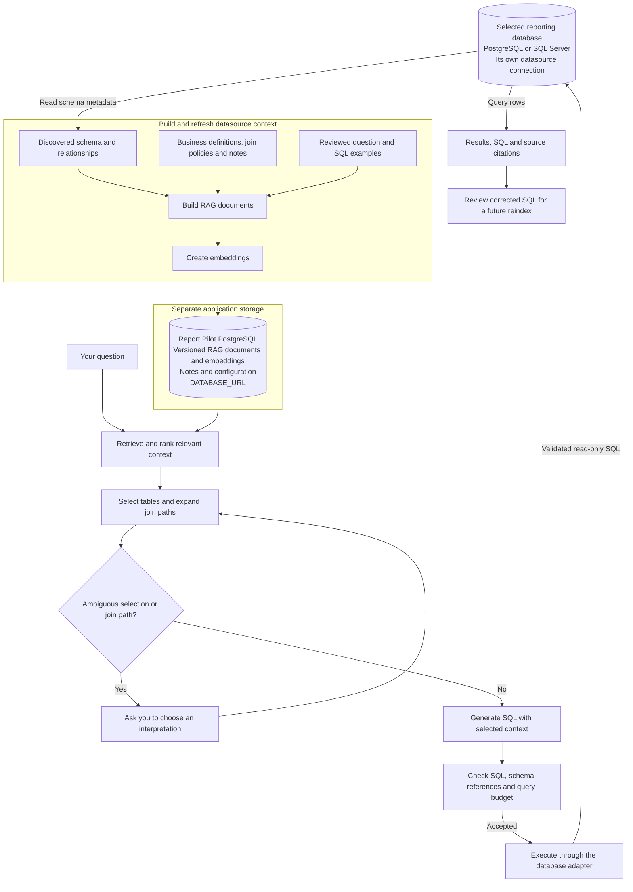

# Give Report Pilot your business context

Report Pilot uses retrieval-augmented generation (RAG) to give the SQL model relevant database structure and business context for each question. You can start with schema discovery alone, then add definitions, approved joins, and reviewed examples as you learn where questions need more context.

## 1. Connect and discover your schema

In **Datasets**, add a PostgreSQL or SQL Server connection using a database account with read-only access. Choose **Introspect Schema** to discover tables, views, columns, keys, and relationships. Introspection also rebuilds the datasource's RAG index.

For SQL Server environments where live introspection is impractical, import a schema-only DDL file. See the [SSMS export instructions](../test-data/README.md#exporting-mssql-schema-via-ssms-for-import). Importing schema describes the database; executing queries still needs a working connection.

Review the discovered objects in **Schema Explorer**. Exclude objects that are irrelevant to reporting and add business names or descriptions where the physical names are unclear.

## 2. Write useful RAG notes

Open **Datasets → RAG Notes** for the connection. Give each note a clear title, keep it active, and save it. Note changes trigger an asynchronous reindex.

Use notes for definitions and reporting conventions that a schema cannot express. For the included DVD Rental fixture:

**Title: Revenue definition**

```text
Revenue means collected payments: SUM(public.payment.amount), grouped by
public.payment.payment_date. Use payment_date for revenue periods.
Film rental_rate is a catalog price, not collected revenue.
```

**Title: Reporting conventions**

```text
For monthly reporting, use calendar months and label them YYYY-MM.
Round revenue and average payment amounts to two decimal places.
If the question gives no date range, use all available payment history.
```

Prefer explicit table and column references, metric definitions, date rules, and exclusions. A note saying "be accurate" adds little useful context.

Notes guide generation. Database grants and application access controls remain the permission boundary.

## 3. Add structured definitions where needed

The semantic layer supports:

| Context | Purpose |
| --- | --- |
| Semantic entities | Give database objects business names and descriptions. |
| Metric definitions | Associate a named metric with a SQL expression and grain. |
| Join policies | Describe approved relationships and their join conditions. |
| Validated examples | Reuse reviewed question-to-SQL pairs. |

Schema Explorer exposes semantic editing and **Join Policies**. The [API reference](api/openapi.yaml) also describes the semantic entity, metric definition, and join policy endpoints.

Check that relationships were actually discovered, especially with a read-only PostgreSQL account. The current PostgreSQL adapter reads foreign keys through `information_schema`, where a SELECT-only role can see tables but no constraint rows. In that situation, add approved join policies in **Schema Explorer → Join Policies**. Keep the database account read-only. A prose RAG note about a join does not create an edge in the schema graph.

The [DVD Rental walkthrough](examples/dvd-rental.md#connect-the-join-path) lists the four join policies used for the category report, including the connector tables.

Feedback with corrected SQL can create examples. Reindexing checks examples against the current schema; selection excludes rejected, stale, incompatible, and low-quality examples and applies count and prompt-size limits. Saving a query by itself does not make it a training example.

## 4. Choose embeddings separately from SQL generation

The LLM provider configured in the UI generates SQL. Embedding configuration belongs to the backend environment:

```dotenv
RAG_EMBED_PROVIDER=auto
RAG_EMBED_MODEL_OPENAI=text-embedding-3-small
```

| Setting | Behavior |
| --- | --- |
| `auto` | Tries OpenAI, then Gemini, then the local fallback. |
| `openai` | Uses OpenAI embeddings, with local fallback on failure. |
| `gemini` | Uses Gemini embeddings, with local fallback on failure. |
| `local` | Uses deterministic hash embeddings without an external API. |

For OpenAI embeddings, supply `OPENAI_API_KEY` to the backend process, or set `RAG_EMBED_API_KEY_REF_OPENAI` to a supported key reference. Gemini uses `GEMINI_API_KEY` or `RAG_EMBED_API_KEY_REF_GEMINI`. A generation key entered directly in the UI is not automatically reused by the embedding service.

Local hash embeddings are a functional fallback with different retrieval quality from a learned embedding model. After changing embedding configuration, restart the backend and choose **Reindex RAG Documents** for the datasource.

Documents and embedding vectors live in **Report Pilot's application PostgreSQL database**, configured with `DATABASE_URL`. This is independent of the reporting datasource connection configured in **Datasets**. The source can be another PostgreSQL database or a SQL Server database, on the same server or a different server. RAG tables, notes, and application configuration belong in application storage, not in the reporting source.

A separate vector database is not required. The current implementation uses PostgreSQL full-text search in application storage to select bounded candidates and scores their stored vectors in the application.

## 5. Understand what happens when you ask



Retrieval is scoped to the selected datasource and current index version. Table candidates combine schema-card matching with retrieved context; the linker selects relevant tables, and schema-graph expansion adds connecting relationships. The final SQL prompt includes selected schema, supporting context, and a bounded set of validated examples.

Supported ambiguities can produce a clarification prompt. Disconnected schemas or invalid SQL can stop the request. Eligible pre-execution validation and PostgreSQL cost-budget failures share one bounded repair attempt; a successful repair must pass the checks again. Actual query-execution errors and thrown EXPLAIN errors are not repaired. Dry run skips database validation, EXPLAIN, and execution.

The **[query pipeline and guardrails guide](query-pipeline.md)** traces both model calls, explains who chooses tables, metrics, columns, and result grain, and distinguishes enforced checks from current limitations. It also covers saved-query and export paths, which do not repeat every orchestration check.

## Check that your context is useful

1. Run a question whose expected SQL and result you know.
2. Inspect the generated SQL, date range, joins, and result grain.
3. Review the returned schema and RAG citations. Citations show supplied context, not proof that every instruction was followed.
4. Compare the answer with an independently written query.
5. Add a precise definition or reviewed example for a demonstrated gap, reindex, and repeat.

Introspection, semantic changes, and corrected-SQL feedback refresh the index automatically. The explicit reindex action is useful after configuration changes or when checking a setup.

The displayed confidence is a heuristic. Valid read-only SQL can still answer the wrong business question, so verify important reports before sharing or scheduling them.
